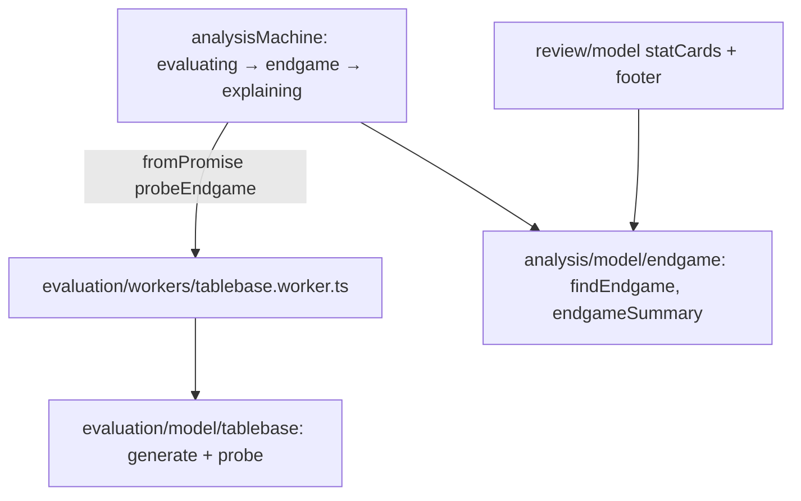

# F5 · Endgame tablebase Design

**Spec**: `.specs/features/endgame-tablebase/spec.md`
**Status**: Approved (decisions delegated by the user on 2026-11-22)

## Architecture

## Components

| File | Responsibility |
| ---- | -------------- |
| `evaluation/model/tablebase/board.ts` | 0..63 squares, king/rook/queen attacks with blockers |
| `evaluation/model/tablebase/generate.ts` | Retrograde analysis: index = ((strongKing·64 + piece)·64 + weakKing)·2 + side; Int16 DTM in plies (−1 unknown/draw); un-moves for both sides; counters of non-losing defender moves |
| `evaluation/model/tablebase/probe.ts` | FEN → material kind, normalised squares and side → `{ result, dtmPlies, strongColor }` or null |
| `evaluation/workers/tablebase.worker.ts` + `evaluation/engine/tablebaseClient.ts` | Generates and caches tables per kind; `probe(fen)` over postMessage |
| `analysis/model/endgame.ts` | First KQK/KRK position, moves actually played until mate, summary object |
| `analysis/machines/analysisMachine.ts` | New `endgame` state between `evaluating` and `explaining` (skipped when not needed) |
| `review/model/review.ts`, `ReviewSidebar.tsx` | 4th stat card and footer status |

## Risks

| Concern | Impact | Mitigation |
| ------- | ------ | ---------- |
| Generation time in jsdom tests | Slow tests | Generation ~1 s; tests generate each table once per file |
| Worker not available in Vitest | Machine tests | Actor is injected; tests provide a fake |
