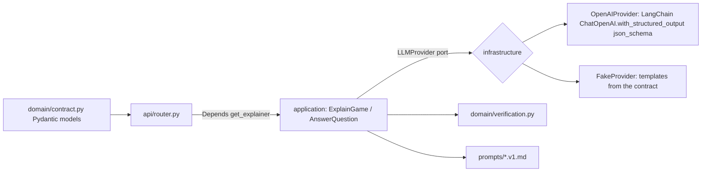

# F6 · AI explanation layer Design

**Spec**: `.specs/features/explanation-api/spec.md`
**Status**: Approved (decisions delegated by the user on 2026-11-22)

## Architecture Overview

## Components

| File | Responsibility |
| ---- | -------------- |
| `domain/contract.py` | `GameContract` (request), `GameExplanation`, `QuestionRequest`, `QuestionAnswer` |
| `domain/verification.py` | `allowed_facts(contract)`, `verify_texts(texts, facts) → list[str]`, `verify_explanation(explanation, contract)` |
| `application/ports.py` | `LLMProvider` Protocol: `generate(system, user, schema) -> T`; `ProviderError` |
| `application/prompts.py` | Loads `prompts/<name>.v<n>.md`, renders with the contract JSON and level rules |
| `application/explain_game.py` | `ExplainGame.__call__(contract)`: prompt → provider → verify → one retry → `ExplanationUnverified` |
| `application/answer_question.py` | Same flow for questions |
| `infrastructure/openai_provider.py` | LangChain adapter |
| `infrastructure/fake_provider.py` | Deterministic texts |
| `infrastructure/provider_factory.py` | `build_provider(settings)` |
| `api/router.py` | `POST /explanations`, `POST /questions`; maps errors to 502/503 |
| `__init__.py` | exports `router` |

## Error Handling Strategy

| Scenario | Handling | HTTP |
| -------- | -------- | ---- |
| Provider exception / missing key | `ProviderError` | 503 `ai_unavailable` |
| Two failed verifications | `ExplanationUnverified` | 502 `explanation_unverified` |
| Invalid body | Pydantic | 422 |
