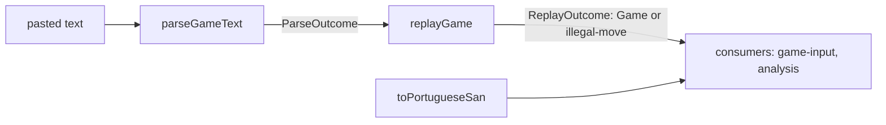

# F1 · Game domain Design

**Spec**: `.specs/features/game-parser-rules/spec.md`
**Status**: Approved (decisions delegated by the user on 2026-11-22)

## Architecture Overview

Two pure stages in `apps/web/src/domains/game/model/`, exposed through `src/domains/game/index.ts`. `chess.js` (AD-002) is only imported by `replay.ts`.



## Components

| File | Responsibility |
| ---- | -------------- |
| `model/types.ts` | `GameFormat`, `Notation`, `GameResult`, `ParsedGame`, `ParseOutcome`, `Ply`, `Game`, `Termination`, `ReplayOutcome`, `IllegalMoveError` |
| `model/notation.ts` | `toPortugueseSan(san)`, `portugueseToEnglishSan(token)`, `detectNotation(tokens)` |
| `model/moveText.ts` | `tokenizeMoveText(text)`: strips comments, variations, NAGs, annotations, move numbers; normalizes `0-0`; splits result token |
| `model/chesscomHtml.ts` | `readChesscomHtml(text)`: DOMParser → `move-text` cells (figurines inlined) + `game-result-node` |
| `model/parseGameText.ts` | size/empty/PGN checks, format detection, assembles `ParsedGame` |
| `model/replay.ts` | `replayGame(parsed)`: chess.js replay, notation fallback, termination/result |

## Data Models

```ts
type GameFormat = "chesscom-html" | "move-list";
type Notation = "en" | "pt" | "undetermined";
type GameResult = "1-0" | "0-1" | "1/2-1/2";
type ParsedGame = { format: GameFormat; notation: Notation; writtenMoves: string[]; sanMoves: string[]; result: GameResult | null };
type ParseOutcome = { kind: "parsed"; game: ParsedGame } | { kind: "empty" } | { kind: "unrecognized" } | { kind: "too-large"; bytes: number };
type Ply = { index: number; moveNumber: number; color: "w" | "b"; san: string; from: string; to: string; piece: PieceSymbol; captured: PieceSymbol | null; promotion: PieceSymbol | null; fenBefore: string; fenAfter: string; isCheck: boolean; isCheckmate: boolean };
type Termination = "checkmate" | "stalemate" | null;
type Game = { format; notation: "en" | "pt"; plies: Ply[]; initialFen: string; finalFen: string; result: GameResult | null; termination: Termination };
type ReplayOutcome = { kind: "legal"; game: Game } | { kind: "illegal-move"; error: { ply: number; moveNumber: number; color: "w" | "b"; writtenMove: string }; plies: Ply[] };
```

`writtenMoves` keep the player's notation (for "O lance 23 (Txa1)…"); `sanMoves` is the English reading.

## Error Handling Strategy

| Scenario | Handling |
| -------- | -------- |
| chess.js throws on an illegal SAN | Caught in `replay.ts`, turned into `illegal-move` with the written token |
| `undetermined` notation fails in English | Retry with the Portuguese reading; report the error of the reading that got further |
| DOMParser unavailable (worker) | Not supported: parsing runs on the main thread (C-03 budget < 1 s) |

## Risks & Concerns

| Concern | Location | Impact | Mitigation |
| ------- | -------- | ------ | ---------- |
| Chess.com may change its markup | `chesscomHtml.ts` | Parser fails | Only depends on `move-text`, `data-figurine`, `game-result-node`; fixture test catches regressions; plain list remains |
| `chess.js` permissive parser accepts odd notations (`Pe4`, `e2e4`) | `replay.ts` | Garbage accepted as moves | The tokenizer only emits SAN-shaped tokens (regex), so permissive forms never reach chess.js |

## Tech Decisions

| Decision | Choice | Rationale |
| -------- | ------ | --------- |
| HTML reading | `DOMParser` | Tolerant of fragments and garbage; standard browser API also in jsdom |
| chess.js mode | default (permissive) SAN parser on pre-validated tokens | Accepts `e8Q` promotions and missing `+`/`#` |
