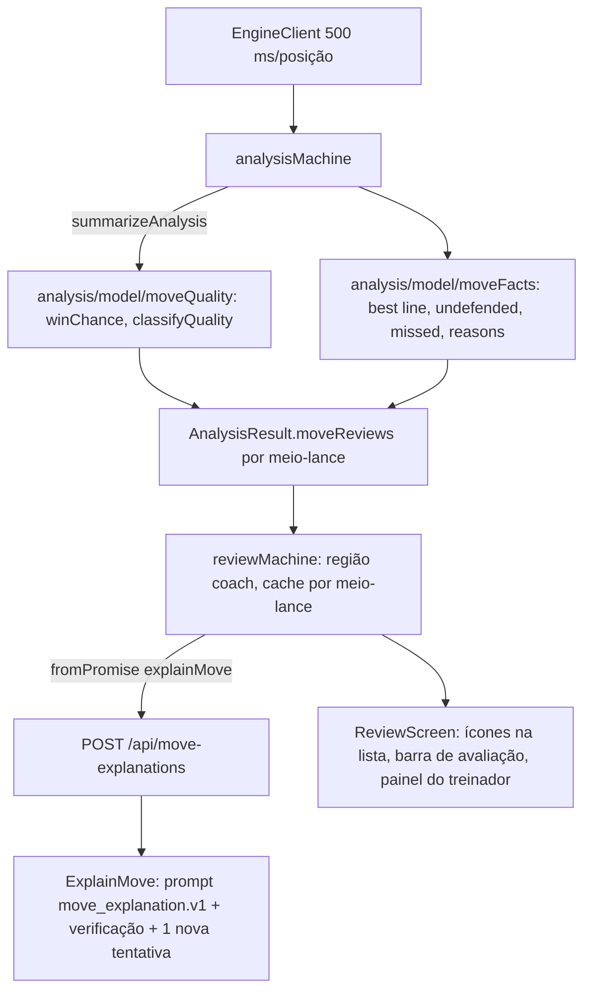

# F9 · Revisão lance a lance Design

**Spec**: `.specs/features/move-review/spec.md`
**Status**: Approved (decisions by the user on 2026-11-24; technical defaults logged in the spec)

## Architecture

## Components

| File | Responsibility |
| ---- | -------------- |
| `evaluation/model/searchPlan.ts` | `MOVETIME_MS = 500` |
| `analysis/model/moveQuality.ts` | `winChance(score, color)` (Lichess formula), `QUALITY_BANDS`, `classifyQuality(lossBefore, previousLoss, isBest)` → `MoveQuality` |
| `analysis/model/moveFacts.ts` | `moveFacts(ply, before, after)`: best move label, line (≤ 6 SAN pt), undefended pieces after, missed material, still-en-prise pieces, best-move reasons |
| `analysis/model/moveReview.ts` | `reviewMoves(game, evaluations)` → `MoveReview[]` (quality + facts + evals), used by `summarizeAnalysis` |
| `game/model/lines.ts` | `enPrisePieces(fen, color)` (attacked and undefended, or attacked by a cheaper piece) |
| `explanation` (api) | `MoveContract`, `MoveExplanation`, `ExplainMove` use case, route, prompt `move_explanation.v1.md`, fake provider template |
| `explanation` (web) | `requestMoveExplanation(contract)`; `buildMoveContract(result, ply)` in analysis/model/contract |
| `review/machines/reviewMachine.ts` | Parallel region `coach`: `explanations: Record<ply, {status, text}>`; on position change request missing ply; `COACH.RETRY` |
| `review/components/CoachPanel.tsx`, `EvalBar.tsx`, `MoveList.tsx` | UI |

## Risks

| Concern | Impact | Mitigation |
| ------- | ------ | ---------- |
| 500 ms × 145 positions ≈ 75 s | Longer wait | Already-visible progress and findings; documented change of the D1 metric |
| win% approximation ≠ Chess.com exact labels | Some moves differ from Chess.com | Logged assumption; thresholds in one constant |
| AI cost per click | Many calls in one review | Session cache (MR-15) |
